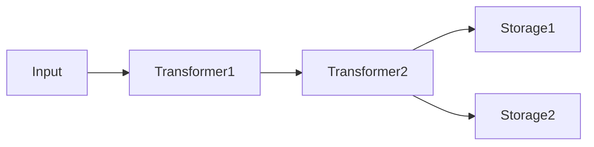
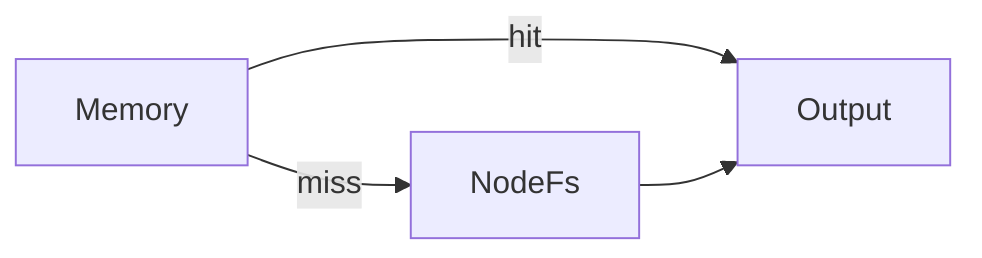

UniKVS の構成は、ビルダーで積んだトランスフォーマーとストレージからなるパイプラインです。このページでは、その構造を根付き有向木 (arborescence) として説明します。



- トランスフォーマーは、データのエンコード・デコードを透過的に行います。
- ストレージは永続化先です。複数指定すると、すべてに並列で書き込みます。

## 構造モデル [#structure-model]

どの構成も、入力を根 (root) とする根付き有向木として表せます。

- 根 (root): 入力 `Input` です。入次数は 0 です。
- 内部頂点 (internal vertex): `use()` で積んだトランスフォーマーです。
- 葉 (leaf): `persist()` で登録したストレージです。出次数は 0 です。
- 辺 (edge) は根から葉へ向かいます。根以外の各頂点は 1 つの親しか持たず、経路が合流する頂点は存在しません。
- ストレージの変換チェーンは、根からその葉までの経路 (path) と一致します。経路が同じなら保存される値も同じです。
- `persist()` はその時点の根からの経路を確定させて葉を 1 つ付けます。`use()` はカーソルを 1 頂点だけ葉方向へ進めます。
- `fork()` はカーソル位置の頂点へ、独立した部分木 (branch) を接ぎ木します。部分木での追加は親の経路に入りません。

## 書き込みと読み取り [#read-and-write]

書き込みと読み取りは、同じ経路を反対方向にたどります。

- 書き込み: 根からすべての葉へ並列に流れ、各葉は自分の経路上の変換だけを適用して保存します。
- 読み取り: 葉を登録順に試し、最初に見つかった葉から根へ経路を逆順にたどってデコードします。



:::note
読み取りは登録順に探して最初に見つかったキーで返します。よく読む保存先を先に登録すると読み取りが速くなります。
:::

## スナップショット [#snapshot]

各ストレージは、`persist()` 呼び出し時点のパイプラインのスナップショットを親パイプラインに使います。`use()` を挟むたびに新しい分岐ができて、先に付けた葉の経路は変わりません。

```ts
import { Compression } from "@unikvs/compression";
import { Memory } from "@unikvs/memory";
import { UniKvs, type Value } from "unikvs";

const kvs = UniKvs.config<{ foo: Value<Uint8Array> }>()
  .use(new Compression("gzip"))
  .persist(new Memory()) // 圧縮のみ
  .persist(new Memory()) // 圧縮のみ (先の葉も変わらない)
  .create();
```

読み取り時に後段で見つかった値を前段に書き戻す read-repair についても、木の構造で説明します。詳細は[複数ストレージ](/guides/multi-storage)のガイドと[パイプライン構成パターン集](/guides/pipeline-patterns)を参照してください。
