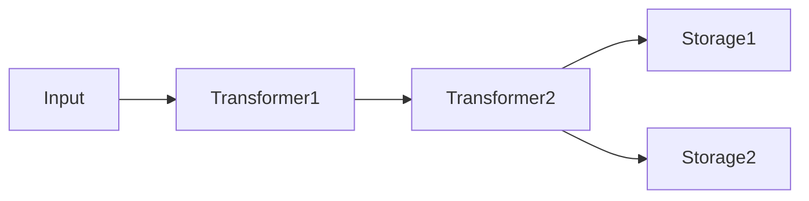

UniKVS は、入力したデータをトランスフォーマーの列で透過的に変換し、指定した複数のストレージへ書き込む KVS クライアントです。このセクションでは、使い方よりも「なぜそう設計されているか」を説明します。

## アーキテクチャー [#architecture]

UniKVS の主要な構成要素は、データを変換するトランスフォーマーと、永続化先であるストレージです。

書き込みはすべてのストレージに並列で行い、読み取りは登録順に探して最初に見つかったキーで返します。各ストレージは `persist()` 呼び出し時点のパイプラインのスナップショットを使うため、トランスフォーマーがどのストレージに適用されるかは登録位置で決まります。

詳細は[アーキテクチャー](./architecture)を参照してください。

## このセクションのページ [#pages]

<CardGroup cols={2}>
  <Card title="アーキテクチャー" href="./architecture" icon="git-branch">
    パイプラインの木構造モデルと、書き込み・読み取りの流れを説明します。
  </Card>
  <Card title="実行時変数" href="./variables" icon="variables">
    操作ごとの設定を渡す Variables の仕組みを説明します。
  </Card>
  <Card title="プラグインの種類" href="./plugins" icon="plug">
    ストレージとトランスフォーマーの役割分担を整理します。
  </Card>
</CardGroup>

手順に沿って学ぶなら[はじめに](/start)、目的別の手順は[ガイド](/guides)を参照してください。
