複数ストレージのガイドを元にした、書き込み・読み取り・分岐・修復の構成パターンと Mermaid 図です。
書き込みはすべてのストレージへ並列に行い、読み取りは登録順に試します。

## 構造モデル (根付き有向木) [#structure-model]

どの構成も、入力を根 (root) とする根付き有向木 (arborescence) として表せます。

- 根 (root): 入力 `Input` です。入次数は 0 です。
- 内部頂点 (internal vertex): `use()` で積んだトランスフォーマーです。
- 葉 (leaf): `persist()` で登録したストレージです。出次数は 0 です。
- 辺 (edge) は根から葉へ向かいます。根以外の各頂点は 1 つの親しか持たず、経路が合流する頂点は存在しません。
- ストレージの変換チェーンは、根からその葉までの経路 (path) と一致します。経路が同じなら保存される値も同じです。
- `persist()` はその時点の根からの経路を確定させて葉を 1 つ付けます。`use()` はカーソルを 1 頂点だけ葉方向へ進めます。
- `fork()` はカーソル位置の頂点へ、独立した部分木 (branch) を接ぎ木します。部分木での追加は親の経路に入りません。

書き込みと読み取りは、同じ経路を反対方向にたどります。

- 書き込み: 根からすべての葉へ並列に流れ、各葉は自分の経路上の変換だけを適用して保存します。
- 読み取り: 葉を登録順に試し、最初に見つかった葉から根へ経路を逆順にたどってデコードします。

以降のパターンは、この木の形と経路の違いとして読めます。

## 1. 単一ストレージ [#single-storage]

根の直下に葉が 1 つだけ付いた、最小の木です。間にトランスフォーマーがないため、経路上で変換は起きません。

```ts
const kvs = UniKvs.config<{ foo: Value<Uint8Array> }>().persist(new Memory()).create();
```

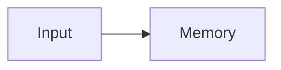

## 2. 単一パイプライン + 単一ストレージ [#single-pipeline]

根から葉まで一直線にトランスフォーマーが並ぶ経路です。`use()` ごとにカーソルが 1 頂点だけ葉方向へ進み、`persist()` がその位置に葉を付けます。

```ts
const kvs = UniKvs.config<{ foo: Value<Uint8Array> }>()
  .use(new Compression("gzip"))
  .use(new ChecksumSha256())
  .persist(new NodeFs(".data"))
  .create();
```

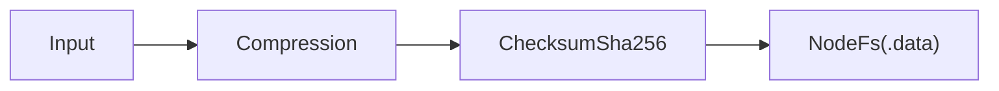

読み取りは同じ経路を逆向き (葉から根) にたどり、経路上の変換を逆順にデコードします。

## 3. 複数ストレージへの並列書き込み (キャッシュ + 永続化) [#parallel-write]

カーソルを動かさずに `persist()` を 2 回呼び出すと、同じ親頂点から 2 つの葉が分岐します。この例では根の出次数が 2 になります。

```ts
const kvs = UniKvs.config<{ foo: Value<Uint8Array> }>()
  .persist(new Memory())
  .persist(new NodeFs(".tmp"))
  .create();
```

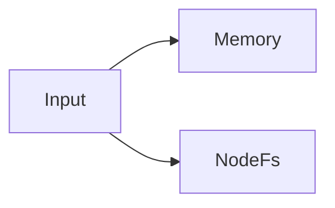

書き込みは両方の葉へ並列に流れます。読み取りは登録順に葉を試し、`Memory` で見つかれば次の `NodeFs` は試しません。

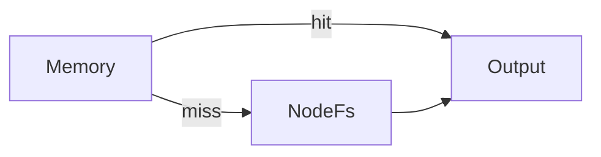

読み取り優先度は葉の登録順そのものです。高速な保存先を先に登録するのが目安です。

## 4. 共通パイプライン + 複数ストレージ [#shared-pipeline]

`use()` の後に `persist()` を並べると、共通の内部頂点から 2 つの葉が分岐します。両方の葉が根から `Compression` までの経路を共有するため、同じ変換結果をそれぞれ保存します。

```ts
const kvs = UniKvs.config<{ foo: Value<Uint8Array> }>()
  .use(new Compression("gzip"))
  .persist(new Memory())
  .persist(new NodeFs(".tmp"))
  .create();
```

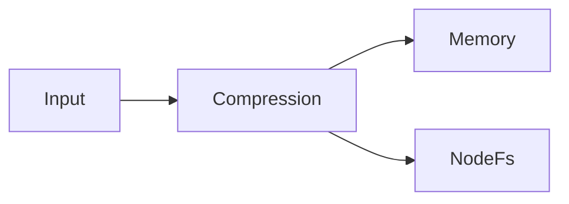

## 5. スナップショット分岐 (ストレージごとに変換を変える) [#snapshot-branch]

`persist()` はその時点の根からの経路をスナップショットとして確定し、葉を付けます。`use()` はカーソルを葉方向へ進めるだけなので、後から付けた葉ほど経路が長くなります。`use()` と `persist()` を交互に呼び出すと、頂点が増えるたびに新しい分岐ができ、先に付けた葉の経路は変わりません。

```ts
const kvs = UniKvs.config<{ foo: Value<Uint8Array> }>()
  .use(new Compression("gzip"))
  .persist(new Memory()) // 圧縮のみ
  .use(new ChecksumSha256())
  .persist(new NodeFs(".tmp")) // 圧縮 + チェックサム
  .create();
```

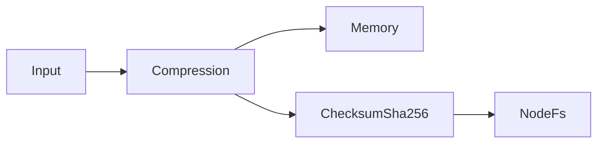

`Memory` の葉には `Compression` だけ、`NodeFs` の葉には `Compression` と `ChecksumSha256` が適用されます。

## 6. fork() による 3 分岐 (キャッシュ / 監査 / 本命) [#fork-three-branches]

`use()` と `persist()` を交互に置くだけでは、後から追加したトランスフォーマーはカーソル上の共通経路に入り、後続の葉にも適用されてしまいます。分岐内だけに置きたい頂点は、`fork()` で独立した部分木として接ぎ木します。A・B・C の共通部分から分岐する典型例です。

```ts
const kvs = UniKvs.config<{ foo: Value<Uint8Array> }>()
  .use(new Compression("gzip")) // A・B・C 共通
  .fork(UniKvs.branch().persist(new Memory())) // A: gzip のみ (高速なキャッシュ)
  .use(new ChecksumSha256()) // B・C 共通
  .fork(UniKvs.branch().use(new ChecksumMd5()).persist(new NodeFs(".cache"))) // B: gzip + チェックサム 2 重 (監査用)
  .persist(new NodeFs(".data")) // C: gzip + チェックサム (本命)
  .create();
```

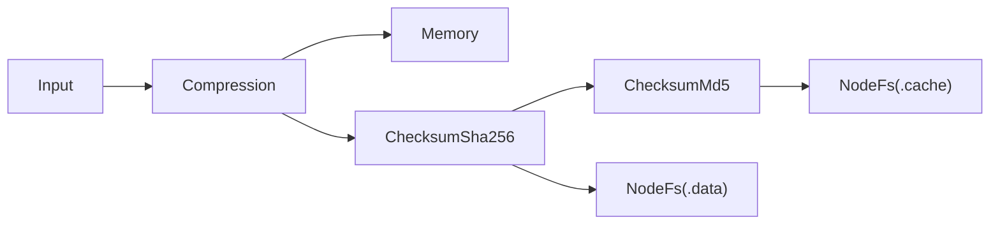

`Compression` までの共通経路から 3 つの葉が分かれます。`Memory` は gzip のみ、`.cache` は gzip + チェックサム 2 重、`.data` は gzip + チェックサムという経路を持ちます。

`fork()` を使わずに `use()` を挟むと、その変換は共通経路に入り、対象の C にも適用されます。共通経路を伸ばす `use()` と、部分木を分ける `fork()` を交互に組み合わせると、木を段階的に拡張できます。

## 7. fork() のネスト・並列分岐 [#nested-fork]

`branch()` の中にさらに `fork()` を配置すると、部分木の中へ部分木を接ぎ木できます。共通部分から圧縮分岐、検証分岐へと続く多段の樹形を作れます。

```ts
const kvs = UniKvs.config<{ foo: Value<any> }>()
  .use(new Cbor())
  .fork(UniKvs.branch().persist(new Memory()))
  .fork(
    UniKvs.branch()
      .use(new Compression("gzip"))
      .fork(UniKvs.branch().persist(new NodeFs(".cache")))
      .persist(new NodeFs(".data")),
  )
  .create();
```

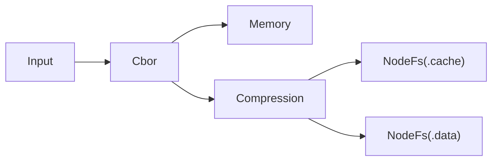

`Cbor` はすべての葉の共通経路にあり、`Compression` は `.cache` と `.data` の経路にだけ含まれます。

## 8. 読み取り時の書き戻し (read-repair) [#read-repair]

`get` / `stream` に `repair: true` を渡すと、最初に見つかった葉で読み取りを終えず、その葉から根まで経路を逆順にたどって全デコードします。デコード結果は、見つからなかった葉へ向けて、その葉自身の根からの経路で再エンコードして書き戻します。

葉ごとに経路上の符号化状態は違うため、デコードの途中で得た値はそのまま使えません。書き戻し先の経路で必ず再エンコードします。

2 段の例 (L1 miss → L2 hit → L1 へ書き戻し):

```ts
const kvs = UniKvs.config<{ foo: Value<Uint8Array> }>()
  .use(new Cbor())
  .fork(
    UniKvs.branch().use(new AllowRepair()).persist(new Memory()), // 圧縮前
  )
  .use(new Compression("gzip"))
  .persist(new NodeFs(".tmp")) // 圧縮後
  .create();

// NodeFs にしかない値は、復元しながら Memory にも書き戻される
const bytes = await kvs.get("foo", { repair: true });
```

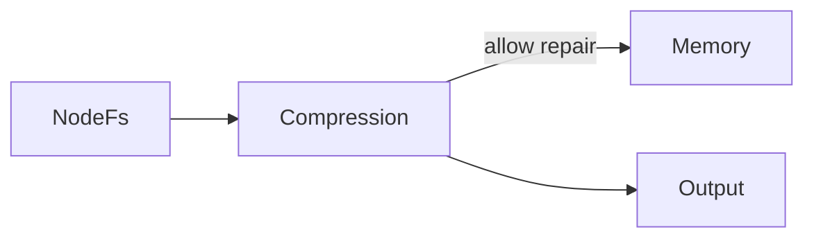

`NodeFs` から `Compression` を逆にたどってデコードし、`Memory` の経路 (`AllowRepair` を含む部分木) で再エンコードして書き戻します。

3 段の例 (L1/L2 miss → L3 hit → L2 へ書き戻し、L1 は拒否):

```ts
const kvs = UniKvs.config<{ foo: Value<Uint8Array> }>()
  .persist(new Memory())
  .use(new Compression("gzip"))
  .use(new AllowRepair())
  .persist(new NodeFs(".cache"))
  .use(new ChecksumSha256())
  .persist(new NodeFs(".data"))
  .create();
```

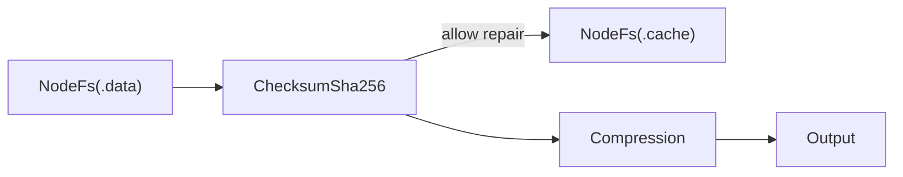

`.data` から `ChecksumSha256` を逆にたどってデコードし、`AllowRepair` がある `.cache` へ書き戻します。`Memory` の経路に `AllowRepair` はないため、`Memory` への書き戻しは行われません。

3 段の例 (L1 miss → L2 hit → L1 への書き戻しは拒否):

```ts
const kvs = UniKvs.config<{ foo: Value<Uint8Array> }>()
  .persist(new Memory())
  .use(new Compression("gzip"))
  .use(new AllowRepair())
  .persist(new NodeFs(".cache"))
  .use(new ChecksumSha256())
  .persist(new NodeFs(".data"))
  .create();
```

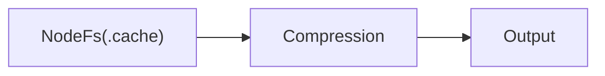

`.cache` から見つかった値をデコードしても、書き戻し先になる `Memory` の経路に `AllowRepair` がないため、書き戻しは拒否され、スキップされます。読み取り自体は成功し、警告ログに残ります。

- 書き戻すのは存在確認で見つからなかったストレージだけです。存在確認自体に失敗したストレージには書き戻しません。
- 既定は無効です。書き込み増幅を避けたいときは指定しないでください。

## 9. 書き戻し可否の制御 (allow-repair) [#allow-repair-control]

書き戻しの可否は、`AllowRepair` 頂点が根からその葉までの経路に含まれるかで決まります。言い換えると、`AllowRepair` を根とする部分木に属する葉だけが書き戻し先になれます。経路に `AllowRepair` がない葉への書き戻しはスキップされ、警告ログに残ります。

```ts
const kvs = UniKvs.config<{ foo: Value<Uint8Array> }>()
  .persist(new Memory()) // AllowRepair なし → 書き戻し対象外
  .use(new Compression("gzip"))
  .use(new AllowRepair())
  .persist(new NodeFs(".cache")) // AllowRepair あり → 書き戻し対象
  .use(new ChecksumSha256())
  .persist(new NodeFs(".data")) // AllowRepair あり → 書き戻し対象だけど、そもそも最終端なので書き戻しされることはない
  .create();
```

`Memory` は `AllowRepair` より根側にあるため部分木の外となり、対象外です。`.cache` と `.data` は部分木の中にあり対象ですが、`.data` は最後に試す葉なので、そもそも書き戻し先になる場面がありません。

```ts
const kvs = UniKvs.config<{ foo: Value<Uint8Array> }>()
  .fork(
    UniKvs.branch().use(new AllowRepair()).persist(new Memory()), // AllowRepair あり → 書き戻し対象
  )
  .use(new Compression("gzip"))
  .persist(new NodeFs(".cache")) // AllowRepair なし → 書き戻し対象外
  .use(new ChecksumSha256())
  .persist(new NodeFs(".data")) // AllowRepair なし → 書き戻し対象外だし、そもそも最終端なので書き戻しされることはない
  .create();
```

`fork()` した部分木の `Memory` にだけ `AllowRepair` があります。`.cache` と `.data` はその部分木の外なので対象外です。

```ts
const kvs = UniKvs.config<{ foo: Value<Uint8Array> }>()
  .use(new AllowRepair())
  .fork(
    UniKvs.branch().persist(new Memory()), // AllowRepair あり → 書き戻し対象
  )
  .use(new Compression("gzip"))
  .persist(new NodeFs(".cache")) // AllowRepair あり → 書き戻し対象
  .use(new ChecksumSha256())
  .persist(new NodeFs(".data")) // AllowRepair あり → 書き戻し対象だけど、最終端なので書き戻しされることはない
  .create();
```

`AllowRepair` が最初にあるため、すべての葉が部分木に属します。

`disable()` で拒否に切り替えると、拒否時は既定では読み取りは成功して警告ログに残ります。`throwOnRepairDenied: true` では読み取りも失敗 (`RepairNotAllowedError`) になります。

## 10. 環境別の切り替え (dev / prod) [#environment-switch]

環境ごとに木を組み替えます。開発時はメモリーだけの最小構成、本番ではファイルや S3 の葉を追加します。

```ts
const storages = process.env.NODE_ENV === "production" ? [new NodeFs(".data")] : [new Memory()];

const kvs = UniKvs.config<{ foo: Value<Uint8Array> }>().persist(storages[0]).create();
```

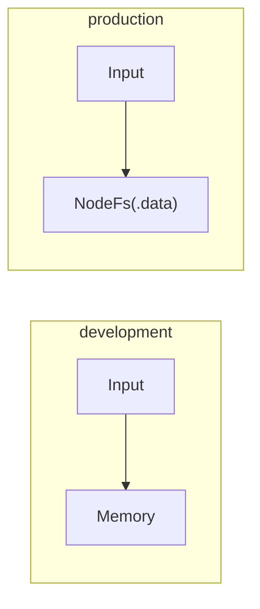

段階移行 (併用から片方へ) では、移行中だけ 2 つの葉へ並列に書き、登録順で `Memory` を優先して読み取ります。

```ts
// 移行中は両方に書いて Memory 優先で読む
const kvs = UniKvs.config<{ foo: Value<Uint8Array> }>()
  .persist(new Memory())
  .persist(new S3())
  .create();
```

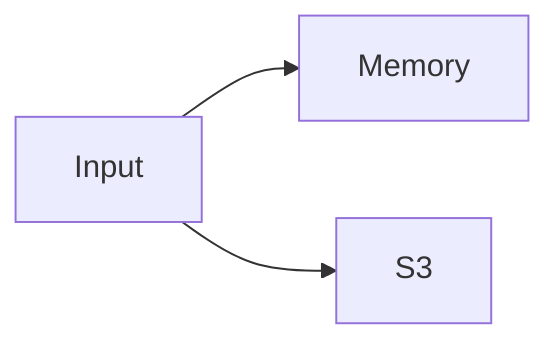

## 11. 監査・アーカイブ (writeonly) [#audit-archive]

`@unikvs/writeonly` で保存先をラップすると、削除操作を既定で無視します。書き込みは届きますが、改変できないアーカイブとして残ります。

```ts
const kvs = UniKvs.config<{ foo: Value<Uint8Array> }>()
  .persist(new Memory())
  .persist(new NodeFs(".data"))
  .use(new WriteOnly())
  .persist(new S3Archive())
  .create();
```

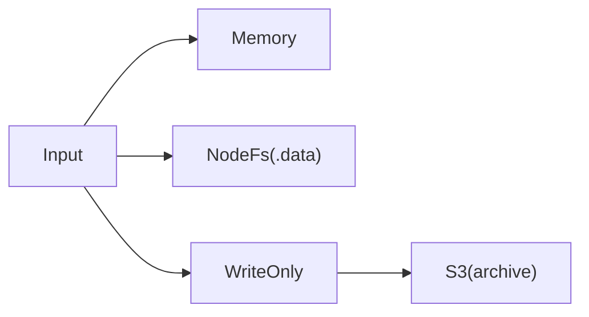

図では `WriteOnly` を経路上の頂点として描いています。書き込みは `S3Archive` まで届きますが、削除操作は `WriteOnly` に達したところで止まり、その先へは伝わりません。

`clear`・`delete` はすべての葉に適用されるため、削除範囲を一部の葉だけに絞りたいときはクライアントを分ける必要があります。

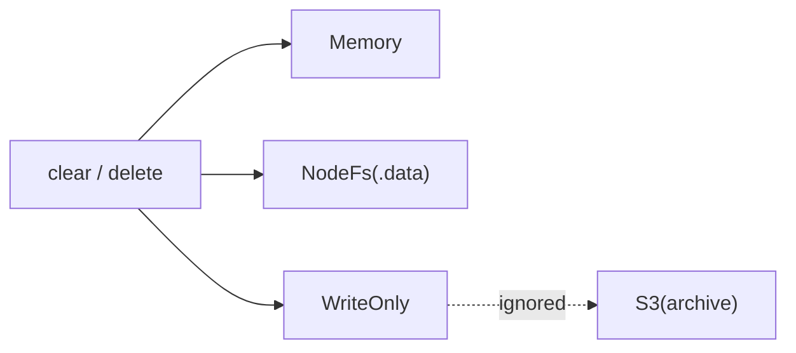

## 12. 直列化・符号化の階層化 (CBOR → 圧縮 → Base64) [#serialization-layers]

根から葉まで一直線に、値型 → バイト列 → テキストと段階を進む経路です。読み取りは逆順にデコードします。

```ts
const kvs = UniKvs.config<{ foo: Value<any> }>()
  .use(new Cbor())
  .use(new Compression("gzip"))
  .use(new Base64())
  .persist(new Memory())
  .create();
```

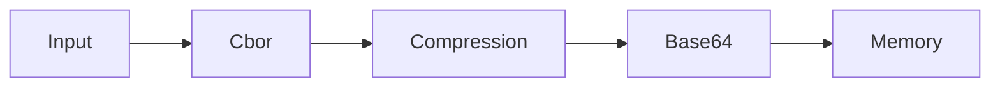

ストレージがバイナリー対応なら、`Base64` を通す部分木と通さない部分木に分けることができます。

```ts
const kvs = UniKvs.config<{ foo: Value<any> }>()
  .use(new Cbor())
  .use(new Compression("gzip"))
  .fork(UniKvs.branch().use(new Base64()).persist(new Memory())) // テキスト系
  .persist(new NodeFs(".data")) // バイナリー系
  .create();
```

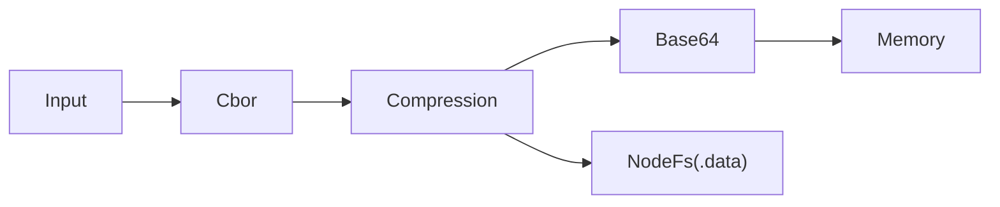

`Memory` の葉は `Base64` まで通して得たテキスト、`NodeFs` の葉は `Base64` を通さないバイナリーを受け取ります。
