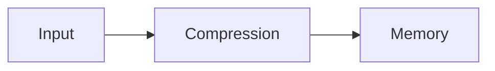
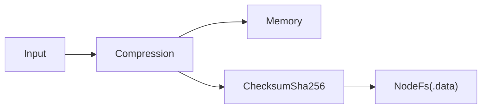

UniKVS では、入力したデータがトランスフォーマーの列を通ってストレージに届きます。`connect()` でトランスフォーマーを、`persist()` でストレージを追加します。



トランスフォーマーを足すと、保存と取得が透過的に変換されます。利用側の `set`・`get` は変わりません。

```ts
import { Compression } from "@unikvs/compression";
import { Memory } from "@unikvs/memory";
import { UniKvs, type Value } from "unikvs";

const kvs = UniKvs.config<{
  foo: Value<Uint8Array>;
}>()
  .connect(new Compression("gzip"))
  .persist(new Memory())
  .create();

await kvs.open();

await kvs.set("foo", Uint8Array.from([0, 1, 2]));
const bytes = await kvs.get("foo"); // gzip 圧縮を自動で展開して返す

await kvs.close();
```

## 追加の順序 [#order]

設定は次の順序で行います。`connect()` と `persist()` は交互に何度でも呼び出せます。

<Steps>
  <Step title="connect(transformer)">トランスフォーマーを追加します (任意)。</Step>
  <Step title="persist(storage)">ストレージを追加します (必須、複数可)。</Step>
  <Step title="fork(branch)">分岐したパイプラインにストレージを追加します (任意)。</Step>
  <Step title="create()">KVS クライアントを作ります (ストレージ登録は必須)。</Step>
</Steps>

各ストレージは、`persist()` を呼び出した時点のパイプラインのスナップショットを使います。そのため、間に `connect()` を挟むと、後から登録したストレージだけが新しいトランスフォーマーを受け取ります。

```ts
const kvs = UniKvs.config<{ foo: Value<Uint8Array> }>()
  .connect(new Compression("gzip"))
  .persist(new Memory()) // 圧縮のみ (登録時点ではまだチェックサムがない)
  .connect(new ChecksumSha256())
  .persist(new NodeFs(".data")) // 圧縮 + チェックサム
  .create();
```



:::tip
バックエンド側が対応しているなら、圧縮より前の段階にチェックサムを置くと、破損チェックがより効果的になります。順序の設計は[複数ストレージ](/guides/multi-storage)のガイドを参照してください。
:::

## 分岐 [#fork]

分岐先での追加を親パイプラインに漏らしたくない場合は `fork()` を使います。分岐先での追加は分岐先に閉じます。

```ts
const kvs = UniKvs.config<{ foo: Value<Uint8Array> }>()
  .connect(new Compression("gzip"))
  .fork(UniKvs.branch().persist(new Memory()))
  .persist(new NodeFs(".data"))
  .create();
```

複数の保存先を組み合わせるパターンは[複数ストレージ](/guides/multi-storage)に、構成のレパートリーは[パイプライン構成パターン集](/guides/pipeline-patterns)にまとめています。
