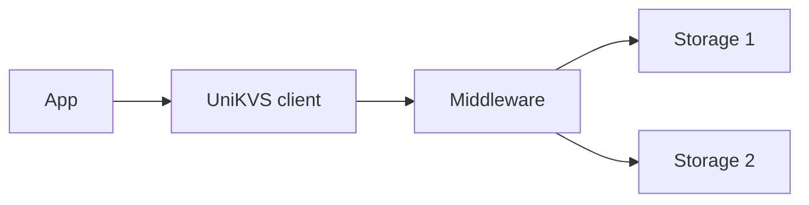
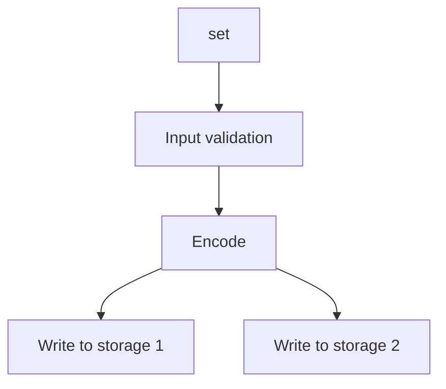
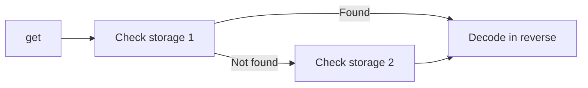

UniKVS separates the middleware transformation layer from the storage persistence layer. A configuration assembled with the builder is used in the same order on every read and write.

## Overview [#overview]

- Middleware transparently transforms values, e.g. compression or JSON conversion.
- Storages persist transformed values. Each backend uses one pipeline.
- The client groups multiple backends and assigns priorities.

## Builder and Branches [#builder]

`Builder` assembles configuration with `use()`, `persist()`, `fork()`, and `build()`.

- `use()` adds middleware to the current pipeline.
- `persist()` registers a backend together with a snapshot of the pipeline at that point. Middleware added after registration does not affect existing registrations.
- `fork()` adds backends to a branched pipeline. Additions on a branch do not leak into the parent pipeline.
- `build()` throws `MissingStorageError` when no backend is registered. The builder is reusable because it freezes the configuration at call time.

For the setup steps, see [Using Multiple Storages](/how-to/multi-storage).

## Write Flow [#write-flow]

Writes go to every backend in parallel.

- Shared transformations run once and the result is reused across backends.
- If some backends fail, failures are grouped into `PluginOperationAggregateError`.
- Stream writes follow the same idea, fanning out to each backend.

## Read Flow [#read-flow]

Reads check backends in registration order and return the first value found.

- Decoding applies the middleware ahead of the found backend in reverse order.
- If no backend has the key, `KeyNotFoundError` is thrown.
- With `repair: true`, values found in later backends are written back to earlier ones. Repair eligibility is controlled with `AllowRepair`.

## Runtime Variables and Cancellation [#vars-and-signal]

Each operation takes runtime variables `vars` and an abort signal `signal`. Variables merge base values with per-operation values, with the per-operation value winning. The signal aborts the operation, which then fails with its reason.

:::note[See package specs for details]
For middleware/storage responsibilities and context details, see the [@unikvs/core](/packages/core) pages.
:::
