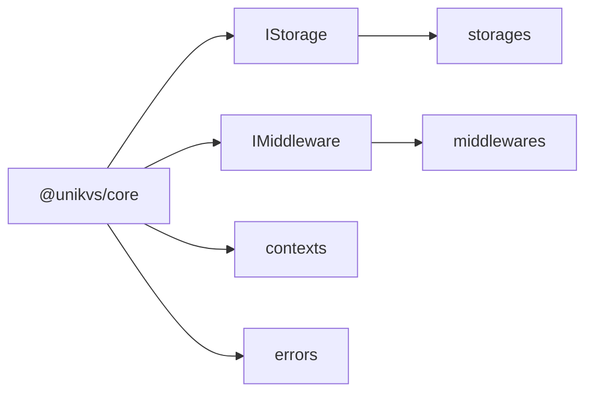

## Overview [#overview]

`@unikvs/core` <Badge>Shared</Badge> is the shared foundation for all packages and plugins. It provides the interfaces plugins implement (`IStorage` / `IMiddleware`), the per-operation contexts, and the shared error foundation.

Its key trait: the only runtime values are error classes; everything else is types. It adds no extra runtime code to bundles and pins plugin contracts in types.



## Installation [#installation]

```package-install
npm i @unikvs/core
```

:::note[Usually no direct install needed]
`unikvs` and each plugin depend on it, so it normally arrives transitively. Depend on it directly when authoring plugins or storages.
:::

`valibot` is used for language switching. Install it separately only when you use message localization. See [Errors › Language switching](./errors#i18n).

ESM only (`sideEffects: false`). Dependencies are just `i18n-error-base` and `maypromise`, both tiny.

## Exports and types [#exports]

Only 9 runtime values are exported from the `@unikvs/core` entry point.

| Runtime value             | Kind     | Description                             | Details                              |
| ------------------------- | -------- | --------------------------------------- | ------------------------------------ |
| `ErrorBase`               | class    | Base of all shared errors               | [Errors](./errors#errors-base)       |
| `InvalidUsageErrorBase`   | class    | Base of usage-mistake errors            | [Errors](./errors#errors-base)       |
| `KeyNotFoundError`        | class    | Key not found                           | [Errors](./errors#errors)            |
| `UnsupportedRuntimeError` | class    | Used outside a supported runtime        | [Errors](./errors#errors)            |
| `InvalidPartSizeError`    | class    | Invalid part size                       | [Errors](./errors#errors)            |
| `StorageAbortedError`     | class    | Abort signal already fired before start | [Errors](./errors#errors)            |
| `RepairNotAllowedError`   | class    | Repair write denied                     | [Errors](./errors#errors)            |
| `ReadonlyVariableError`   | class    | Write to a readonly variable            | [Errors](./errors#errors)            |
| `setErrorMessage`         | function | Registers per-language messages         | [Errors](./errors#set-error-message) |

Everything else is types only. Sources are split by file:

| Source                      | Contents                            | Runtime values | Details                                 |
| --------------------------- | ----------------------------------- | -------------- | --------------------------------------- |
| `errors.ts`                 | Error classes and `setErrorMessage` | yes            | [Errors](./errors)                      |
| `pipeline-context.types.ts` | Per-operation contexts              | no             | [Pipeline contexts](./pipeline-context) |
| `storage.types.ts`          | Destination plugin interface        | no             | [Storage](./storage)                    |
| `middleware.types.ts`       | Transform plugin interface          | no             | [Middleware](./middleware)              |
| `stream.types.ts`           | Web-standard stream aliases         | no             | [Streams](./stream)                     |

```ts
import {
  type ErrorMeta,
  type IStorage,
  type IMiddleware,
  type IPipelineContext,
  type IGetContext,
  type ISetContext,
  type IReadableStream,
  KeyNotFoundError,
} from "@unikvs/core";
```

:::tip[Type-only subpaths]
`storage.types.js`, `middleware.types.js`, `pipeline-context.types.js`, and `stream.types.js` are types only and export no runtime values.
:::

## Guide [#guide]

Read by purpose.

<CardGroup cols={2}>
  <Card title="Errors" href="./errors" icon="triangle-alert">
    The error foundation, the 6 shared errors, and language switching.
  </Card>
  <Card title="Pipeline contexts" href="./pipeline-context" icon="git-branch">
    Runtime variables and the per-operation context list.
  </Card>
  <Card title="Storage" href="./storage" icon="hard-drive">
    `IStorage`, the interface destination plugins implement.
  </Card>
  <Card title="Middleware" href="./middleware" icon="layers">
    `IMiddleware`, the interface transform plugins implement.
  </Card>
</CardGroup>

<CardGroup cols={2}>
  <Card title="Streams" href="./stream" icon="waves">
    Web-standard stream aliases and chunk-type handling.
  </Card>
</CardGroup>

When authoring a plugin, start from the [storage](./storage#example) or [middleware](./middleware#example) examples for the big picture.
