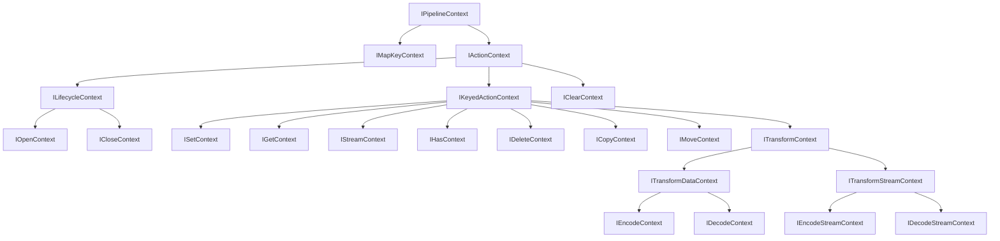

## Overview [#overview]

Pipeline contexts are a gateway for reading and writing per-operation runtime variables (`vars`). Every context extends `IPipelineContext`, with `key`, `signal`, `source`, and similar info added per operation kind.

Plugin authors take keys and signals from the context passed as hook arguments, and read behavior settings from `vars`.

## Reading and writing variables [#variables]

Use the four methods `get`, `set`, `setReadonly`, and `snapshot`. The `set` family returns `this`, so calls can chain.

```ts
import type { IPipelineContext } from "@unikvs/core";

declare const ctx: IPipelineContext<{ readonly count: number }>;

const count: number = ctx.get("count"); // typed read
const unknownValue: unknown = ctx.get("anything-else"); // undeclared keys are unknown

ctx.set("count", 1).setReadonly("count", 2); // returns this, so calls chain

const snapshot = ctx.snapshot(); // shallow copy of the current variables
```

Declaring type arguments like `{ count: number }` types getting and setting that key. Undeclared keys are `unknown`, and assigning a wrong type is a type error.

```ts
// @ts-expect-error count is a number, so a string is rejected
ctx.set("count", "not a number");
```

### Declaration merging [#variables-merging]

You can also add types via declaration merging on the global `UniKvsPipelineContextTypes`. Use it to define variable names shared by multiple plugins in one place.

```ts
declare global {
  interface UniKvsPipelineContextTypes {
    readonly "test:count": number;
  }
}

declare const ctx: IPipelineContext;

const count: number = ctx.get("test:count");
ctx.set("test:count", 1); // assigning a string is a type error
```

Type-argument declarations and `UniKvsPipelineContextTypes` merging combine: a key in either resolves with types. Keys in neither are `unknown`.

:::warning[Beware readonly]
`setReadonly()` Writes to a variable pinned by [`ReadonlyVariableError`](./errors#error-readonly-variable) are thrown. Use it for values you do not want callers to overwrite, such as plugin-internal defaults.
:::

## Context hierarchy [#hierarchy]

Contexts inherit in layers. Lower layers pin down the operation further and carry more info.



## Context list [#contexts]

Each operation kind carries fixed info.

| Type                                            | `action`            | Main added properties                                        |
| ----------------------------------------------- | ------------------- | ------------------------------------------------------------ |
| [`IMapKeyContext`](#imapkeycontext)             | —                   | `key: string`                                                |
| [`IActionContext`](#iactioncontext)             | 10 operations       | `signal: AbortSignal`                                        |
| [`ILifecycleContext`](#ilifecyclecontext)       | `"open" \| "close"` | `signal`                                                     |
| [`IOpenContext`](#iopencontext)                 | `"open"`            | `signal`                                                     |
| [`ICloseContext`](#iclosecontext)               | `"close"`           | `signal`                                                     |
| [`IKeyedActionContext`](#ikeyedactioncontext)   | 7 keyed operations  | `key` / `signal`                                             |
| [`ISetContext`](#isetcontext)                   | `"set"`             | `key` / `signal`                                             |
| [`IGetContext`](#igetcontext)                   | `"get"`             | `key` / `signal` / `repair`                                  |
| [`IStreamContext`](#istreamcontext)             | `"stream"`          | `key` / `signal` / `repair`                                  |
| [`IHasContext`](#ihascontext)                   | `"has"`             | `key` / `signal`                                             |
| [`IDeleteContext`](#ideletecontext)             | `"delete"`          | `key` / `signal`                                             |
| [`ICopyContext`](#icopycontext)                 | `"copy"`            | `key` / `destinationKey` / `signal`                          |
| [`IMoveContext`](#imovecontext)                 | `"move"`            | `key` / `destinationKey` / `signal`                          |
| [`IClearContext`](#iclearcontext)               | `"clear"`           | `signal`                                                     |
| [`IEncodeContext`](#iencodecontext)             | `"set"`             | `source` / `destination?` (for data conversion)              |
| [`IDecodeContext`](#idecodecontext)             | `"get"`             | `source` / `destination?` (for data conversion)              |
| [`IEncodeStreamContext`](#iencodestreamcontext) | `"set"`             | `source` / `destination?` (for `IReadableStream` conversion) |
| [`IDecodeStreamContext`](#idecodestreamcontext) | `"stream"`          | `source` / `destination?` (for `IReadableStream` conversion) |

### Keys and lifecycle [#contexts-key-lifecycle]

`IMapKeyContext` is key-mapping only and carries just `key` (used by [middleware `mapKey`](./middleware#hooks)). It carries no `signal`.

`IActionContext` carries `signal: AbortSignal` and 10 kinds of `action` (`"open" | "close" | "set" | "get" | "stream" | "has" | "delete" | "clear" | "copy" | "move"`). `ILifecycleContext` narrows to `"open" | "close"`, and `IOpenContext` / `ICloseContext` each pin to one kind.

### Keyed operations [#contexts-keyed]

`IKeyedActionContext` adds `key: string` and narrows `action` to the 7 kinds `"set" | "get" | "stream" | "has" | "delete" | "copy" | "move"`. The following `ISetContext`, `IGetContext`, `IStreamContext`, `IHasContext`, and `IDeleteContext` each pin `action` to one kind. `ICopyContext` and `IMoveContext` also carry the destination key in `destinationKey`. `IClearContext` carries no key, so it extends `IActionContext` directly with `action` `"clear"`.

The middleware `use` hook receives these 8 kinds (`set` / `get` / `stream` / `has` / `delete` / `copy` / `move` / `clear`) together. Narrowing by `action` gives type-safe access to each operation's `key`, `repair`, and `destinationKey`.

```ts
import type { IMiddleware } from "@unikvs/core";

export function describe(use: IMiddleware.UseContext): string {
  switch (use.action) {
    case "set":
    case "get":
    case "stream":
    case "has":
    case "delete":
    case "copy":
    case "move": {
      return `${use.action}: ${use.key}`;
    }
    case "clear": {
      return "clear";
    }
  }
}
```

### Conversion [#contexts-transform]

`ITransformContext` carries pre/post-conversion values. `source` is the input, and the result is assigned to the optional `destination`.

| Type                   | `action`   | `source`                        | `destination`             |
| ---------------------- | ---------- | ------------------------------- | ------------------------- |
| `IEncodeContext`       | `"set"`    | raw data                        | after encoding            |
| `IDecodeContext`       | `"get"`    | stored value                    | after decoding            |
| `IEncodeStreamContext` | `"set"`    | readable stream (raw chunks)    | converted readable stream |
| `IDecodeStreamContext` | `"stream"` | readable stream (stored chunks) | converted readable stream |

Data conversion (`ITransformDataContext` family) `source` and `destination` are the values themselves. In stream conversion, on the other hand, (`ITransformStreamContext` family) `source` and `destination` are `IReadableStream`. Check type arguments for value vs. chunk. See [Streams](./stream#transform).

## Repair [#repair]

`IGetContext` and `IStreamContext` carry a read-time repair (`repair`) request. It holds whether a value found in a later storage should be written back to earlier ones.

```ts
import type { IGetContext } from "@unikvs/core";

declare const ctx: IGetContext;

if (ctx.repair.enabled) {
  console.log(ctx.repair.targets); // readonly [string, ...string[]] (one or more)
} else {
  console.log(ctx.repair.targets); // readonly [] (empty)
}
```

When `enabled` is `false`, `targets` is an empty array; when `true`, it is an array of one or more display names. Narrowing by `enabled` gives type-safe access to `targets`. When repair is denied, [`RepairNotAllowedError`](./errors#error-repair-not-allowed) is used. Eligibility is controlled by [`@unikvs/allow-repair`](/packages/allow-repair).

## API reference [#api]

Per-symbol reference. Each member row is directly linkable.

### `IPipelineContext` [#ipipelinecontext]

Gateway for reading and writing runtime variables (`vars`). Every context extends it.

<TypeTable
  type={{
    get: {
      type: "[#ipipelinecontext-get] get<const TName extends ParamName<TTypes>>(name: TName): ParamValue<TTypes, TName>",
      required: true,
      description: "Gets a variable.",
    },
    set: {
      type: "[#ipipelinecontext-set] set<const TName extends ParamName<TTypes>>(name: TName, value: ParamValue<TTypes, TName>): this",
      required: true,
      description: "Sets a variable. Returns `this`.",
    },
    setReadonly: {
      type: "[#ipipelinecontext-setreadonly] setReadonly<const TName extends ParamName<TTypes>>(name: TName, value: ParamValue<TTypes, TName>): this",
      required: true,
      description: "Sets a variable as readonly. Returns `this`.",
    },
    snapshot: {
      type: "[#ipipelinecontext-snapshot] snapshot(): VariablesSnapshot",
      required: true,
      description: "Creates a shallow copy of the current runtime variables.",
    },
  }}
/>

### `VariablesSnapshot` [#variables-snapshot]

Shallow copy of the runtime variables returned by `snapshot()`. It can be used as `ReadonlyMap<string, unknown>`. Values are not cloned, so object values share the same reference.

### `IMapKeyContext` [#imapkeycontext]

Key-mapping-only context carrying just `key`.

<TypeTable
  type={{
    key: {
      type: "[#imapkeycontext-key] string",
      required: true,
      description: "The key being mapped.",
    },
  }}
/>

### `IActionContext` [#iactioncontext]

`signal` with 10 kinds of `action`, shared by all operations.

<TypeTable
  type={{
    signal: {
      type: "[#iactioncontext-signal] AbortSignal",
      required: true,
      description: "The signal aborting the operation.",
    },
    action: {
      type: '[#iactioncontext-action] "open" | "close" | "set" | "get" | "stream" | "has" | "delete" | "clear" | "copy" | "move"',
      required: true,
      description: "The operation kind.",
    },
  }}
/>

### `ILifecycleContext` [#ilifecyclecontext]

Lifecycle context with `action` narrowed to `"open" | "close"`.

<TypeTable
  type={{
    action: {
      type: '[#ilifecyclecontext-action] "open" | "close"',
      required: true,
      description: "The operation kind.",
    },
  }}
/>

### `IOpenContext` [#iopencontext]

Initialization context with `action` pinned to `"open"`.

<TypeTable
  type={{
    action: {
      type: '[#iopencontext-action] "open"',
      required: true,
      description: "The operation kind.",
    },
  }}
/>

### `ICloseContext` [#iclosecontext]

Teardown context with `action` pinned to `"close"`.

<TypeTable
  type={{
    action: {
      type: '[#iclosecontext-action] "close"',
      required: true,
      description: "The operation kind.",
    },
  }}
/>

### `IKeyedActionContext` [#ikeyedactioncontext]

Context adding `key` and narrowing `action` to the 7 keyed operations.

<TypeTable
  type={{
    action: {
      type: '[#ikeyedactioncontext-action] "set" | "get" | "stream" | "has" | "delete" | "copy" | "move"',
      required: true,
      description: "The operation kind.",
    },
    key: {
      type: "[#ikeyedactioncontext-key] string",
      required: true,
      description: "The target key.",
    },
  }}
/>

### `ISetContext` [#isetcontext]

Write context with `action` pinned to `"set"`.

<TypeTable
  type={{
    action: {
      type: '[#isetcontext-action] "set"',
      required: true,
      description: "The operation kind.",
    },
  }}
/>

### `IGetContext` [#igetcontext]

Read context with `action` pinned to `"get"`, carrying a repair (`repair`) request.

<TypeTable
  type={{
    action: {
      type: '[#igetcontext-action] "get"',
      required: true,
      description: "The operation kind.",
    },
  }}
/>

### `IStreamContext` [#istreamcontext]

Stream-read context with `action` pinned to `"stream"`, carrying a repair (`repair`) request.

<TypeTable
  type={{
    action: {
      type: '[#istreamcontext-action] "stream"',
      required: true,
      description: "The operation kind.",
    },
  }}
/>

### `IHasContext` [#ihascontext]

Presence-check context with `action` pinned to `"has"`.

<TypeTable
  type={{
    action: {
      type: '[#ihascontext-action] "has"',
      required: true,
      description: "The operation kind.",
    },
  }}
/>

### `IDeleteContext` [#ideletecontext]

Delete context with `action` pinned to `"delete"`.

<TypeTable
  type={{
    action: {
      type: '[#ideletecontext-action] "delete"',
      required: true,
      description: "The operation kind.",
    },
  }}
/>

### `ICopyContext` [#icopycontext]

Copy context with `action` pinned to `"copy"`. `key` is the source key, and `destinationKey` is the destination key.

<TypeTable
  type={{
    action: {
      type: '[#icopycontext-action] "copy"',
      required: true,
      description: "The operation kind.",
    },
    key: {
      type: "[#icopycontext-key] string",
      required: true,
      description: "The source key.",
    },
    destinationKey: {
      type: "[#icopycontext-destination-key] string",
      required: true,
      description: "The destination key.",
    },
  }}
/>

### `IMoveContext` [#imovecontext]

Move context with `action` pinned to `"move"`. `key` is the source key, and `destinationKey` is the destination key.

<TypeTable
  type={{
    action: {
      type: '[#imovecontext-action] "move"',
      required: true,
      description: "The operation kind.",
    },
    key: {
      type: "[#imovecontext-key] string",
      required: true,
      description: "The source key.",
    },
    destinationKey: {
      type: "[#imovecontext-destination-key] string",
      required: true,
      description: "The destination key.",
    },
  }}
/>

### `IClearContext` [#iclearcontext]

Clear-all context with `action` pinned to `"clear"`, carrying no key.

<TypeTable
  type={{
    action: {
      type: '[#iclearcontext-action] "clear"',
      required: true,
      description: "The operation kind.",
    },
  }}
/>

### `ITransformContext` [#itransformcontext]

Context carrying pre/post-conversion values. `source` is the input, and `destination` receives the conversion result.

<TypeTable
  type={{
    action: {
      type: '[#itransformcontext-action] "set" | "get" | "stream"',
      required: true,
      description: "The operation kind.",
    },
    source: {
      type: "[#itransformcontext-source] TSource",
      required: true,
      description: "The pre-conversion value.",
    },
    destination: {
      type: "[#itransformcontext-destination] TDestination | undefined",
      description: "Where the conversion result is assigned.",
    },
  }}
/>

### `ITransformDataContext` [#itransformdatacontext]

Data-conversion context converting the values themselves.

<TypeTable
  type={{
    action: {
      type: '[#itransformdatacontext-action] "set" | "get"',
      required: true,
      description: "The operation kind.",
    },
  }}
/>

### `IEncodeContext` [#iencodecontext]

Encode context with `action` pinned to `"set"`.

<TypeTable
  type={{
    action: {
      type: '[#iencodecontext-action] "set"',
      required: true,
      description: "The operation kind.",
    },
  }}
/>

### `IDecodeContext` [#idecodecontext]

Decode context with `action` pinned to `"get"`.

<TypeTable
  type={{
    action: {
      type: '[#idecodecontext-action] "get"',
      required: true,
      description: "The operation kind.",
    },
  }}
/>

### `ITransformStreamContext` [#itransformstreamcontext]

Stream-conversion context. `source` and `destination` are `IReadableStream`.

<TypeTable
  type={{
    action: {
      type: '[#itransformstreamcontext-action] "set" | "stream"',
      required: true,
      description: "The operation kind.",
    },
  }}
/>

### `IEncodeStreamContext` [#iencodestreamcontext]

Stream-encode context with `action` pinned to `"set"`.

<TypeTable
  type={{
    action: {
      type: '[#iencodestreamcontext-action] "set"',
      required: true,
      description: "The operation kind.",
    },
  }}
/>

### `IDecodeStreamContext` [#idecodestreamcontext]

Stream-decode context with `action` pinned to `"stream"`.

<TypeTable
  type={{
    action: {
      type: '[#idecodestreamcontext-action] "stream"',
      required: true,
      description: "The operation kind.",
    },
  }}
/>
