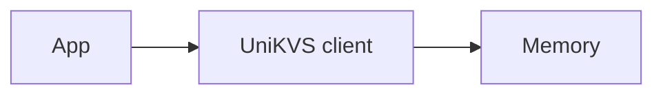

In this tutorial, you will store and read back values using in-memory storage. It takes about 10 minutes. Set the internals aside and build something working first.

## Goal [#goal]

When you finish, you will be able to:

- Assemble a client with `Builder`.
- Initialize with `open()` and read/write with `set()` and `get()`.
- Clean up with `close()`.

## Prerequisites [#prerequisites]

- A working Node.js environment.
- A TypeScript project.

## Steps [#steps]

<Steps>
  <Step title="Install packages">
    Install `unikvs` and `@unikvs/memory`.

    ```package-install
    npm install unikvs @unikvs/memory
    ```

  </Step>
  <Step title="Assemble the client">
    Pass in-memory storage to `Builder` to create a client. Here the key `greeting` stores a string.

    ```ts
    import { Memory } from "@unikvs/memory";
    import * as unikvs from "unikvs";

    const kvs = new unikvs.Builder<{
      greeting: unikvs.PlainValue<string>;
    }>()
      .persist(new Memory())
      .build();
    ```

  </Step>
  <Step title="Store and read back">
    Initialize with `open()`, then run `set()` and `get()`. Close with `close()` when done.

    ```ts
    await kvs.open();
    await kvs.set("greeting", "hello");

    const value = await kvs.get("greeting");
    console.log(value); // "hello"

    await kvs.close();
    ```

  </Step>
</Steps>

:::warning[Do not forget storage registration]
Call `persist()` at least once before `build()`. Calling `build()` with no registration throws `MissingStorageError`.
:::

## Review [#review]

The resulting setup looks like this:



- `persist()` registers a backend.
- `build()` creates the client.
- `open()` is required before reading and writing.

## Next Steps [#next-steps]

<CardGroup cols={2}>
  <Card title="Installation" href="/how-to/installation" icon="download">
    Installation steps for your runtime.
  </Card>
  <Card title="Architecture" href="/explanation/architecture" icon="book-open">
    Understand the write and read flows.
  </Card>
  <Card title="Value Model" href="/explanation/value-model" icon="boxes">
    Single values vs. streams.
  </Card>
  <Card title="Storage Comparison" href="/reference/comparison" icon="database">
    Choose a backend beyond memory.
  </Card>
</CardGroup>
