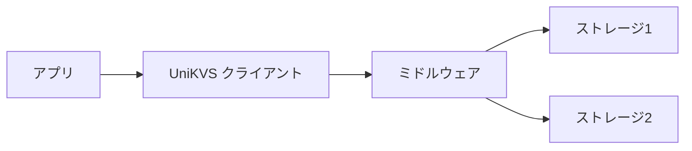
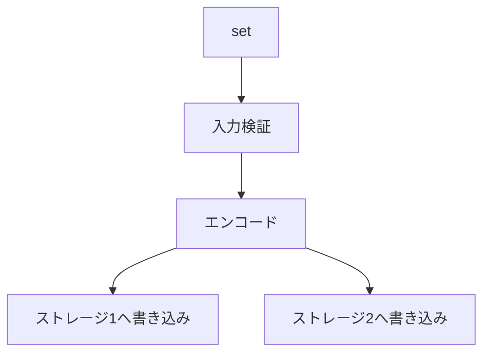
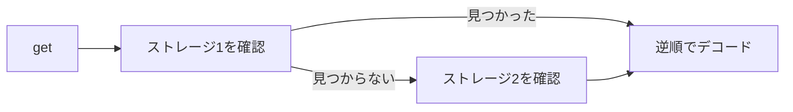

UniKVS はミドルウェアの変換層とストレージの保存層を分けて考えます。ビルダーで組み立てた構成は、読み書きのたびに同じ順序で使われます。

## 全体像 [#overview]

- ミドルウェアは値を透過的に変換します。たとえば圧縮や JSON 変換が該当します。
- ストレージは変換後の値を保存します。保存先ごとに 1 つのパイプラインを使います。
- クライアントは複数の保存先をまとめて扱い、優先順位を付けます。

## ビルダーと分岐 [#builder]

`Builder` は `use()` と `persist()` と `fork()` と `build()` で構成を組み立てます。

- `use()` は現在のパイプラインにミドルウェアを追加します。
- `persist()` はその時点のパイプラインのスナップショットとともに保存先を登録します。そのため、登録後に追加したミドルウェアは既存の登録には影響しません。
- `fork()` は分岐したパイプラインに保存先を追加します。分岐先での追加は親パイプラインに漏れません。
- `build()` は保存先が 1 件もない場合に `MissingStorageError` を投げます。呼び出し時点の構成を固定するため、ビルダーは再利用できます。

設定の手順は[複数の保存先を使う](/how-to/multi-storage)を参照してください。

## 書き込みの流れ [#write-flow]

書き込みはすべての保存先に並列で行います。

- 共有する変換は 1 回だけ実行し、結果を各保存先で使い回します。
- 一部の保存先で失敗した場合は `PluginOperationAggregateError` にまとめて投げます。
- ストリームの書き込みも同じ考え方で、各保存先へ分岐して送ります。

## 読み取りの流れ [#read-flow]

読み取りは登録順に保存先を確認し、最初に見つかった値を返します。

- デコードは、見つかった保存先の手前に並ぶミドルウェアを逆順に適用します。
- どの保存先にもない場合は `KeyNotFoundError` を投げます。
- `repair: true` を付けると、後段で見つかった値を前段へ書き戻します。書き戻しの可否は `AllowRepair` で制御します。

## 実行時変数とキャンセル [#vars-and-signal]

各操作は実行時変数 `vars` と中断信号 `signal` を受け取ります。変数は基本値と操作ごとの値を結合し、操作側の値が勝ちます。信号は操作の中断に使い、中断した操作は理由とともに失敗します。

:::note[詳細はパッケージ側の仕様を参照]
ミドルウェアとストレージの責務やコンテキストの詳細は、[@unikvs/core](/packages/core)の各ページを参照してください。
:::
