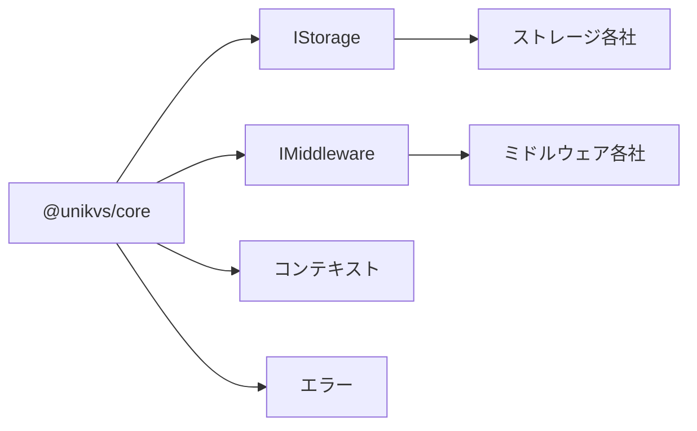

## 概要 [#overview]

`@unikvs/core` <Badge>共有</Badge> はすべてのパッケージとプラグインで共有される基盤です。ストレージやミドルウェアなどのプラグインが実装すべきインターフェース (`IStorage`・`IMiddleware`) と、操作ごとに受け渡されるコンテキスト、そして共通のエラー基盤を提供します。

最大の特徴は実行時の値としてエラークラスのみを提供し、それ以外はすべて型のみである点です。バンドルに余計な実行コードを持ち込まず、プラグイン間の契約を型で固定します。



## インストール [#installation]

```package-install
npm i @unikvs/core
```

:::note[通常は直接インストール不要です]
`unikvs` や各プラグインが依存しているため、通常は推移的に取得されます。プラグインやストレージを自作するときに直接依存します。
:::

言語切り替えのために `valibot` を使います。メッセージの多言語化を利用する場合のみ、使う側が別途インストールします。詳しくは[エラー › 言語切り替え](./errors#i18n)を参照してください。

ESM 専用 (`sideEffects: false`) です。依存は `i18n-error-base` と `maypromise` のみで、いずれも軽量です。

## 公開値と型 [#exports]

エントリーポイント (`@unikvs/core`) から公開される実行時の値は 9 個だけです。

| 実行時の値                | 種類   | 説明                           | 詳しい説明                           |
| ------------------------- | ------ | ------------------------------ | ------------------------------------ |
| `ErrorBase`               | クラス | すべての共通エラーの基底       | [エラー](./errors#errors-base)       |
| `InvalidUsageErrorBase`   | クラス | 使い方の誤りを示すエラーの基底 | [エラー](./errors#errors-base)       |
| `KeyNotFoundError`        | クラス | キーが見つからない             | [エラー](./errors#errors)            |
| `UnsupportedRuntimeError` | クラス | 対応ランタイム外で使用した     | [エラー](./errors#errors)            |
| `InvalidPartSizeError`    | クラス | 不正なパートサイズ             | [エラー](./errors#errors)            |
| `StorageAbortedError`     | クラス | 開始前に中断シグナルが発火済み | [エラー](./errors#errors)            |
| `RepairNotAllowedError`   | クラス | 書き戻しが拒否された           | [エラー](./errors#errors)            |
| `ReadonlyVariableError`   | クラス | 読み取り専用変数への書き込み   | [エラー](./errors#errors)            |
| `setErrorMessage`         | 関数   | 言語ごとのメッセージを登録する | [エラー](./errors#set-error-message) |

それ以外はすべて型のみです。ソース上はファイルごとに分かれています。

| ソース                      | 内容                                 | 実行時の値 | 詳しい説明                                     |
| --------------------------- | ------------------------------------ | ---------- | ---------------------------------------------- |
| `errors.ts`                 | エラークラスと `setErrorMessage`     | あり       | [エラー](./errors)                             |
| `pipeline-context.types.ts` | 操作ごとのコンテキスト               | なし       | [パイプラインコンテキスト](./pipeline-context) |
| `storage.types.ts`          | 保存先プラグインのインターフェース   | なし       | [ストレージ](./storage)                        |
| `middleware.types.ts`       | 中間処理プラグインのインターフェース | なし       | [ミドルウェア](./middleware)                   |
| `stream.types.ts`           | Web 標準ストリームのエイリアス       | なし       | [ストリーム](./stream)                         |

```ts
import {
  type ErrorMeta,
  type IStorage,
  type IMiddleware,
  type IPipelineContext,
  type IGetContext,
  type ISetContext,
  type IReadableStream,
  KeyNotFoundError,
} from "@unikvs/core";
```

:::tip[型のみのサブパス]
`storage.types.js`・`middleware.types.js`・`pipeline-context.types.js`・`stream.types.js` は型のみで、実行時の値は公開しません。
:::

## ドキュメント案内 [#guide]

目的ごとに読み進めます。

<CardGroup cols={2}>
  <Card title="エラー" href="./errors" icon="triangle-alert">
    エラー基盤と 6 種類の共通エラー、言語切り替えの方法です。
  </Card>
  <Card title="パイプラインコンテキスト" href="./pipeline-context" icon="git-branch">
    実行時変数と操作ごとのコンテキストの一覧です。
  </Card>
  <Card title="ストレージ" href="./storage" icon="hard-drive">
    保存先プラグインが実装する `IStorage` の説明です。
  </Card>
  <Card title="ミドルウェア" href="./middleware" icon="layers">
    中間処理プラグインが実装する `IMiddleware` の説明です。
  </Card>
</CardGroup>

<CardGroup cols={2}>
  <Card title="ストリーム" href="./stream" icon="waves">
    Web 標準ストリームのエイリアスとチャンク型の扱いです。
  </Card>
</CardGroup>

プラグインを自作する場合は、[ストレージ](./storage#example)や[ミドルウェア](./middleware#example)の実装例から入ると全体像をつかめます。
