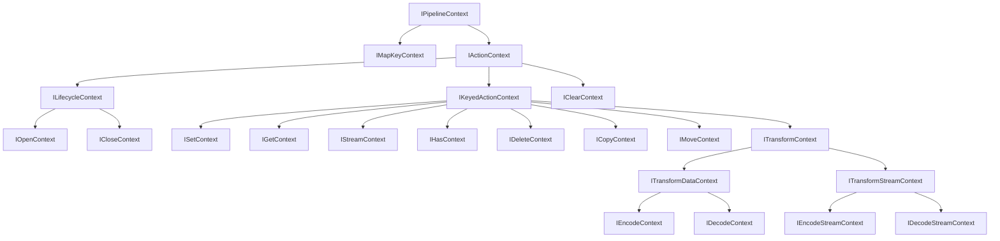

## 概要 [#overview]

パイプラインコンテキストは操作ごとに受け渡される実行時変数 (`vars`) を読み書きする窓口です。すべてのコンテキストが `IPipelineContext` を継承し、操作の種類ごとに `key`・`signal`・`source` などの情報が追加されます。

プラグイン作者はフックの引数として渡されるコンテキストからキーやシグナルを取り出し、`vars` から動作設定を読み取ります。

## 変数の読み書き [#variables]

`get`・`set`・`setReadonly`・`snapshot` の 4 メソッドで変数を扱います。`set` 系は `this` を返すため、メソッドチェーンできます。

```ts
import type { IPipelineContext } from "@unikvs/core";

declare const ctx: IPipelineContext<{ readonly count: number }>;

const count: number = ctx.get("count"); // 型付きで取得
const unknownValue: unknown = ctx.get("anything-else"); // 未登録のキーは unknown

ctx.set("count", 1).setReadonly("count", 2); // this を返すため連鎖できる

const snapshot = ctx.snapshot(); // 現在の変数の浅いコピー
```

型引数で `{ count: number }` のように宣言すると、そのキーの取得と設定が型付けされます。宣言にないキーは `unknown` として扱われ、誤った型の代入は型エラーになります。

```ts
// @ts-expect-error count は number のため文字列は渡せない
ctx.set("count", "not a number");
```

### 宣言マージ [#variables-merging]

グローバルな `UniKvsPipelineContextTypes` への宣言マージでも型を足せます。複数のプラグインが共有する変数名を一箇所で定義するときに使います。

```ts
declare global {
  interface UniKvsPipelineContextTypes {
    readonly "test:count": number;
  }
}

declare const ctx: IPipelineContext;

const count: number = ctx.get("test:count");
ctx.set("test:count", 1); // 文字列の代入は型エラー
```

型引数の宣言と `UniKvsPipelineContextTypes` の宣言マージは結合され、どちらかにあるキーは型付きで解決されます。どちらにもないキーは `unknown` です。

:::warning[読み取り専用に注意]
`setReadonly()` で固定した変数への書き込みは [`ReadonlyVariableError`](./errors#error-readonly-variable) を投げます。プラグイン内部の既定値など、呼び出し側に上書きされたくない値に使います。
:::

## コンテキストの階層 [#hierarchy]

コンテキストは層状に継承されます。下の層ほど操作が特定され、持つ情報が増えます。



## コンテキストの一覧 [#contexts]

操作の種類ごとに含まれる情報が決まっています。

| 型                                              | `action`            | 主な追加プロパティー                                |
| ----------------------------------------------- | ------------------- | --------------------------------------------------- |
| [`IMapKeyContext`](#imapkeycontext)             | —                   | `key: string`                                       |
| [`IActionContext`](#iactioncontext)             | 10 種の操作         | `signal: AbortSignal`                               |
| [`ILifecycleContext`](#ilifecyclecontext)       | `"open" \| "close"` | `signal`                                            |
| [`IOpenContext`](#iopencontext)                 | `"open"`            | `signal`                                            |
| [`ICloseContext`](#iclosecontext)               | `"close"`           | `signal`                                            |
| [`IKeyedActionContext`](#ikeyedactioncontext)   | 7 種のキー操作      | `key`・`signal`                                     |
| [`ISetContext`](#isetcontext)                   | `"set"`             | `key`・`signal`                                     |
| [`IGetContext`](#igetcontext)                   | `"get"`             | `key`・`signal`・`repair`                           |
| [`IStreamContext`](#istreamcontext)             | `"stream"`          | `key`・`signal`・`repair`                           |
| [`IHasContext`](#ihascontext)                   | `"has"`             | `key`・`signal`                                     |
| [`IDeleteContext`](#ideletecontext)             | `"delete"`          | `key`・`signal`                                     |
| [`ICopyContext`](#icopycontext)                 | `"copy"`            | `key`・`destinationKey`・`signal`                   |
| [`IMoveContext`](#imovecontext)                 | `"move"`            | `key`・`destinationKey`・`signal`                   |
| [`IClearContext`](#iclearcontext)               | `"clear"`           | `signal`                                            |
| [`IEncodeContext`](#iencodecontext)             | `"set"`             | `source`・`destination?` (データ変換用)             |
| [`IDecodeContext`](#idecodecontext)             | `"get"`             | `source`・`destination?` (データ変換用)             |
| [`IEncodeStreamContext`](#iencodestreamcontext) | `"set"`             | `source`・`destination?` (`IReadableStream` 変換用) |
| [`IDecodeStreamContext`](#idecodestreamcontext) | `"stream"`          | `source`・`destination?` (`IReadableStream` 変換用) |

### キーとライフサイクル [#contexts-key-lifecycle]

`IMapKeyContext` はキー変換専用で `key` のみを持ちます ([ミドルウェアの `mapKey`](./middleware#hooks) で使います)。`signal` は持ちません。

`IActionContext` は `signal: AbortSignal` と 10 種の `action` (`"open" | "close" | "set" | "get" | "stream" | "has" | "delete" | "clear" | "copy" | "move"`) を持ちます。`ILifecycleContext` は `"open" | "close"` に絞られ、`IOpenContext`・`ICloseContext` はそれぞれ 1 種に絞られます。

### キー操作 [#contexts-keyed]

`IKeyedActionContext` は `key: string` を加え、`action` を `"set" | "get" | "stream" | "has" | "delete" | "copy" | "move"` の 7 種に絞ります。以降の `ISetContext`・`IGetContext`・`IStreamContext`・`IHasContext`・`IDeleteContext` は `action` を 1 種に固定します。`ICopyContext` と `IMoveContext` はコピー先・移動先の `destinationKey` も持ちます。`IClearContext` はキーを伴わないため `IKeyedActionContext` ではなく `IActionContext` を直接継承し、`action` は `"clear"` です。

ミドルウェアの `use` フックはこれら 8 種 (`set`・`get`・`stream`・`has`・`delete`・`copy`・`move`・`clear`) をまとめて受けます。`action` で絞り込むと、各操作の `key` や `repair`、`destinationKey` に型安全に触れます。

```ts
import type { IMiddleware } from "@unikvs/core";

export function describe(use: IMiddleware.UseContext): string {
  switch (use.action) {
    case "set":
    case "get":
    case "stream":
    case "has":
    case "delete":
    case "copy":
    case "move": {
      return `${use.action}: ${use.key}`;
    }
    case "clear": {
      return "clear";
    }
  }
}
```

### 変換 [#contexts-transform]

`ITransformContext` は変換前後の値を運びます。`source` が入力で、`destination` (任意) に変換結果を代入します。

| 型                     | `action`   | `source`                          | `destination`              |
| ---------------------- | ---------- | --------------------------------- | -------------------------- |
| `IEncodeContext`       | `"set"`    | 生データ                          | エンコード後               |
| `IDecodeContext`       | `"get"`    | 保存値                            | デコード後                 |
| `IEncodeStreamContext` | `"set"`    | 読み取りストリーム (生チャンク)   | 変換後の読み取りストリーム |
| `IDecodeStreamContext` | `"stream"` | 読み取りストリーム (保存チャンク) | 変換後の読み取りストリーム |

データ変換 (`ITransformDataContext` 系) の `source` と `destination` は値そのものです。一方、ストリーム変換 (`ITransformStreamContext` 系) の `source` と `destination` は `IReadableStream` です。値かチャンクかを型引数で確認します。詳しくは[ストリーム](./stream#transform)を参照してください。

## 書き戻し [#repair]

`IGetContext` と `IStreamContext` は読み取り時の書き戻し (`repair`) 要求を持ちます。後段のストレージで見つかった値を前段へ書き戻すかどうかが入ります。

```ts
import type { IGetContext } from "@unikvs/core";

declare const ctx: IGetContext;

if (ctx.repair.enabled) {
  console.log(ctx.repair.targets); // readonly [string, ...string[]] (1 件以上)
} else {
  console.log(ctx.repair.targets); // readonly [] (空)
}
```

`enabled` が `false` のとき `targets` は空配列、`true` のとき 1 件以上の表示名の配列です。`enabled` で絞り込むと `targets` の中身に型安全に触れます。書き戻しが拒否された場合は [`RepairNotAllowedError`](./errors#error-repair-not-allowed) が使われます。可否は [`@unikvs/allow-repair`](/packages/allow-repair) で制御します。

## API リファレンス [#api]

シンボルごとのリファレンスです。各メンバーの行にも直接リンクできます。

### `IPipelineContext` [#ipipelinecontext]

実行時変数 (`vars`) を読み書きする窓口です。すべてのコンテキストが継承します。

<TypeTable
  type={{
    get: {
      type: "[#ipipelinecontext-get] get<const TName extends ParamName<TTypes>>(name: TName): ParamValue<TTypes, TName>",
      required: true,
      description: "変数を取得します。",
    },
    set: {
      type: "[#ipipelinecontext-set] set<const TName extends ParamName<TTypes>>(name: TName, value: ParamValue<TTypes, TName>): this",
      required: true,
      description: "変数を設定します。`this` を返します。",
    },
    setReadonly: {
      type: "[#ipipelinecontext-setreadonly] setReadonly<const TName extends ParamName<TTypes>>(name: TName, value: ParamValue<TTypes, TName>): this",
      required: true,
      description: "変数を読み取り専用で設定します。`this` を返します。",
    },
    snapshot: {
      type: "[#ipipelinecontext-snapshot] snapshot(): VariablesSnapshot",
      required: true,
      description: "現在の実行時変数の浅いコピーを作成します。",
    },
  }}
/>

### `VariablesSnapshot` [#variables-snapshot]

`snapshot()` が返す実行時変数の浅いコピーです。`ReadonlyMap<string, unknown>` として扱えます。値の参照はコピーされないため、値がオブジェクトの場合は同じ参照を共有します。

### `IMapKeyContext` [#imapkeycontext]

キー変換専用のコンテキストです。`key` のみを持ちます。

<TypeTable
  type={{
    key: {
      type: "[#imapkeycontext-key] string",
      required: true,
      description: "変換対象のキーです。",
    },
  }}
/>

### `IActionContext` [#iactioncontext]

`signal` と 10 種の `action` を持つ、すべての操作に共通するコンテキストです。

<TypeTable
  type={{
    signal: {
      type: "[#iactioncontext-signal] AbortSignal",
      required: true,
      description: "操作の中断信号です。",
    },
    action: {
      type: '[#iactioncontext-action] "open" | "close" | "set" | "get" | "stream" | "has" | "delete" | "clear" | "copy" | "move"',
      required: true,
      description: "操作の種類です。",
    },
  }}
/>

### `ILifecycleContext` [#ilifecyclecontext]

`action` を `"open" | "close"` に絞ったライフサイクル用コンテキストです。

<TypeTable
  type={{
    action: {
      type: '[#ilifecyclecontext-action] "open" | "close"',
      required: true,
      description: "操作の種類です。",
    },
  }}
/>

### `IOpenContext` [#iopencontext]

`action` を `"open"` に固定した初期化用コンテキストです。

<TypeTable
  type={{
    action: {
      type: '[#iopencontext-action] "open"',
      required: true,
      description: "操作の種類です。",
    },
  }}
/>

### `ICloseContext` [#iclosecontext]

`action` を `"close"` に固定した終了処理用コンテキストです。

<TypeTable
  type={{
    action: {
      type: '[#iclosecontext-action] "close"',
      required: true,
      description: "操作の種類です。",
    },
  }}
/>

### `IKeyedActionContext` [#ikeyedactioncontext]

`key` を加え、`action` をキー操作の 7 種に絞ったコンテキストです。

<TypeTable
  type={{
    action: {
      type: '[#ikeyedactioncontext-action] "set" | "get" | "stream" | "has" | "delete" | "copy" | "move"',
      required: true,
      description: "操作の種類です。",
    },
    key: {
      type: "[#ikeyedactioncontext-key] string",
      required: true,
      description: "操作対象のキーです。",
    },
  }}
/>

### `ISetContext` [#isetcontext]

`action` を `"set"` に固定した書き込み用コンテキストです。

<TypeTable
  type={{
    action: {
      type: '[#isetcontext-action] "set"',
      required: true,
      description: "操作の種類です。",
    },
  }}
/>

### `IGetContext` [#igetcontext]

`action` を `"get"` に固定した読み取り用コンテキストです。書き戻し (`repair`) 要求を持ちます。

<TypeTable
  type={{
    action: {
      type: '[#igetcontext-action] "get"',
      required: true,
      description: "操作の種類です。",
    },
  }}
/>

### `IStreamContext` [#istreamcontext]

`action` を `"stream"` に固定したストリーム読み取り用コンテキストです。書き戻し (`repair`) 要求を持ちます。

<TypeTable
  type={{
    action: {
      type: '[#istreamcontext-action] "stream"',
      required: true,
      description: "操作の種類です。",
    },
  }}
/>

### `IHasContext` [#ihascontext]

`action` を `"has"` に固定した存在確認用コンテキストです。

<TypeTable
  type={{
    action: {
      type: '[#ihascontext-action] "has"',
      required: true,
      description: "操作の種類です。",
    },
  }}
/>

### `IDeleteContext` [#ideletecontext]

`action` を `"delete"` に固定した削除用コンテキストです。

<TypeTable
  type={{
    action: {
      type: '[#ideletecontext-action] "delete"',
      required: true,
      description: "操作の種類です。",
    },
  }}
/>

### `ICopyContext` [#icopycontext]

`action` を `"copy"` に固定したコピー用コンテキストです。`key` がコピー元、`destinationKey` がコピー先です。

<TypeTable
  type={{
    action: {
      type: '[#icopycontext-action] "copy"',
      required: true,
      description: "操作の種類です。",
    },
    key: {
      type: "[#icopycontext-key] string",
      required: true,
      description: "コピー元のキーです。",
    },
    destinationKey: {
      type: "[#icopycontext-destination-key] string",
      required: true,
      description: "コピー先のキーです。",
    },
  }}
/>

### `IMoveContext` [#imovecontext]

`action` を `"move"` に固定した移動用コンテキストです。`key` が移動元、`destinationKey` が移動先です。

<TypeTable
  type={{
    action: {
      type: '[#imovecontext-action] "move"',
      required: true,
      description: "操作の種類です。",
    },
    key: {
      type: "[#imovecontext-key] string",
      required: true,
      description: "移動元のキーです。",
    },
    destinationKey: {
      type: "[#imovecontext-destination-key] string",
      required: true,
      description: "移動先のキーです。",
    },
  }}
/>

### `IClearContext` [#iclearcontext]

`action` を `"clear"` に固定した全削除用コンテキストです。キーを伴いません。

<TypeTable
  type={{
    action: {
      type: '[#iclearcontext-action] "clear"',
      required: true,
      description: "操作の種類です。",
    },
  }}
/>

### `ITransformContext` [#itransformcontext]

変換前後の値を運ぶコンテキストです。`source` が入力で、`destination` に変換結果を代入します。

<TypeTable
  type={{
    action: {
      type: '[#itransformcontext-action] "set" | "get" | "stream"',
      required: true,
      description: "操作の種類です。",
    },
    source: {
      type: "[#itransformcontext-source] TSource",
      required: true,
      description: "変換前の値です。",
    },
    destination: {
      type: "[#itransformcontext-destination] TDestination | undefined",
      description: "変換結果の代入先です。",
    },
  }}
/>

### `ITransformDataContext` [#itransformdatacontext]

値そのものを変換するデータ変換用コンテキストです。

<TypeTable
  type={{
    action: {
      type: '[#itransformdatacontext-action] "set" | "get"',
      required: true,
      description: "操作の種類です。",
    },
  }}
/>

### `IEncodeContext` [#iencodecontext]

`action` を `"set"` に固定したエンコード用コンテキストです。

<TypeTable
  type={{
    action: {
      type: '[#iencodecontext-action] "set"',
      required: true,
      description: "操作の種類です。",
    },
  }}
/>

### `IDecodeContext` [#idecodecontext]

`action` を `"get"` に固定したデコード用コンテキストです。

<TypeTable
  type={{
    action: {
      type: '[#idecodecontext-action] "get"',
      required: true,
      description: "操作の種類です。",
    },
  }}
/>

### `ITransformStreamContext` [#itransformstreamcontext]

ストリームを変換するコンテキストです。`source` と `destination` は `IReadableStream` です。

<TypeTable
  type={{
    action: {
      type: '[#itransformstreamcontext-action] "set" | "stream"',
      required: true,
      description: "操作の種類です。",
    },
  }}
/>

### `IEncodeStreamContext` [#iencodestreamcontext]

`action` を `"set"` に固定したストリームエンコード用コンテキストです。

<TypeTable
  type={{
    action: {
      type: '[#iencodestreamcontext-action] "set"',
      required: true,
      description: "操作の種類です。",
    },
  }}
/>

### `IDecodeStreamContext` [#idecodestreamcontext]

`action` を `"stream"` に固定したストリームデコード用コンテキストです。

<TypeTable
  type={{
    action: {
      type: '[#idecodestreamcontext-action] "stream"',
      required: true,
      description: "操作の種類です。",
    },
  }}
/>
