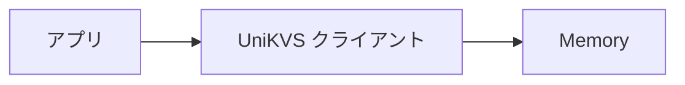

このチュートリアルでは、メモリーストレージを使って値の保存と読み戻しを行います。所要時間は 10 分程度です。細かい仕組みは後回しにして、まず動くものを作ります。

## 完成物のイメージ [#goal]

この手順を終えると、次のことができるようになります。

- `Builder` でクライアントを組み立てます。
- `open()` で初期化し、`set()` と `get()` で読み書きします。
- `close()` で後片づけをします。

## 前提条件 [#prerequisites]

- Node.js が使える環境を用意します。
- TypeScript のプロジェクトを用意します。

## 手順 [#steps]

<Steps>
  <Step title="パッケージをインストールする">
    `unikvs` と `@unikvs/memory` をインストールします。

    ```package-install
    npm install unikvs @unikvs/memory
    ```

  </Step>
  <Step title="クライアントを組み立てる">
    `Builder` にメモリーストレージを渡し、クライアントを作ります。ここではキー `greeting` に文字列を保存します。

    ```ts
    import { Memory } from "@unikvs/memory";
    import * as unikvs from "unikvs";

    const kvs = new unikvs.Builder<{
      greeting: unikvs.PlainValue<string>;
    }>()
      .persist(new Memory())
      .build();
    ```

  </Step>
  <Step title="保存して読み戻す">
    `open()` で初期化してから、`set()` と `get()` を実行します。使い終わったら `close()` で閉じます。

    ```ts
    await kvs.open();
    await kvs.set("greeting", "hello");

    const value = await kvs.get("greeting");
    console.log(value); // "hello"

    await kvs.close();
    ```

  </Step>
</Steps>

:::warning[ストレージ未登録に注意]
`build()` の前に `persist()` を少なくとも 1 回呼んでください。登録がないまま `build()` を呼ぶと `MissingStorageError` を投げます。
:::

## 振り返り [#review]

今回の構成は次のとおりです。



- `persist()` で保存先を登録します。
- `build()` でクライアントを作ります。
- 読み書きの前には `open()` が必要です。

## 次のステップ [#next-steps]

<CardGroup cols={2}>
  <Card title="インストール" href="/how-to/installation" icon="download">
    実行環境に合わせた導入手順を確認します。
  </Card>
  <Card title="アーキテクチャー" href="/explanation/architecture" icon="book-open">
    書き込みと読み取りの流れを理解します。
  </Card>
  <Card title="値のモデル" href="/explanation/value-model" icon="boxes">
    単一値とストリームの使い分けを確認します。
  </Card>
  <Card title="ストレージ比較" href="/reference/comparison" icon="database">
    メモリー以外の保存先を選びます。
  </Card>
</CardGroup>
